# Arduino based Sensor Fusion Projects

Self-directed projects by Priyan: IMU orientation filtering, gesture/motion detection, and GPS + INS navigation using an Arduino and a Bosch BNO055 9-DOF IMU. Built independently, outside of any school club, to learn how sensing, estimation, and control fit together. 

## Repository map

| Folder | What it is |
|---|---|
| `myINS/ins`, `myINS/insAll` | Orientation estimation and motion detection from accelerometer + gyro |
| `myGPS/gps`, `myGPS/gpsPlusIns` | GPS reading, then GPS + INS fusion with a complementary filter |
| `myGPS/gpsplusInsKalman` | Same pipeline, adding an exploratory Kalman filter and a simulated GPS outage |
| `mySmartCar4.0` | Autonomous smart-car sketches (with and without servo) |
| `MyBlink` | Arduino hardware bring-up |

## Hardware and software
- Arduino board [model]
- Adafruit BNO055 9-DOF IMU (I2C, external crystal)
- GPS module [model], NMEA at 9600 baud on SoftwareSerial pins 2/3
- Serial output at 115200 baud, logged as CSV and plotted in MATLAB
- Libraries: Adafruit BNO055, Adafruit Unified Sensor, TinyGPSPlus

---

## Project 1: INS orientation and motion detection (`myINS/insAll`)

**Goal:** Get a clean, low-lag tilt estimate from a noisy accelerometer and a drifting gyro, then detect motion to use as input features for a drone-control ML model.

**Conventions:** +X, +Y, +Z are defined relative to the board. Roll (φ), pitch (θ), and yaw (ψ) are counterclockwise rotations about those axes.

**Estimates compared (about 100 Hz loop):**

| Estimate | Method |
|---|---|
| Accel-only | `atan2` of accelerometer axes |
| Low-pass filter (LPF) | `θ = 0.90·θ + 0.10·θ_accel` |
| Complementary filter | 0.95 gyro-integrated + 0.05 accelerometer |
| Kalman filter (exploratory) | 2-state angle + gyro bias |

### Results

**1. Noise when stationary.** Raw accelerometer angles are noisy even with the board nearly still. Both filters smooth them.

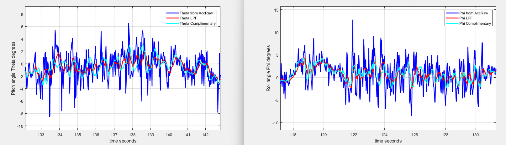

**2. Lag during motion.** For repeated pitch motion, the LPF (red) is visibly late and under-reads the peaks. The complementary filter (cyan) follows the accelerometer's timing and amplitude with far less noise. This is the central tradeoff: the LPF buys smoothness with lag, and the complementary filter doesn't.

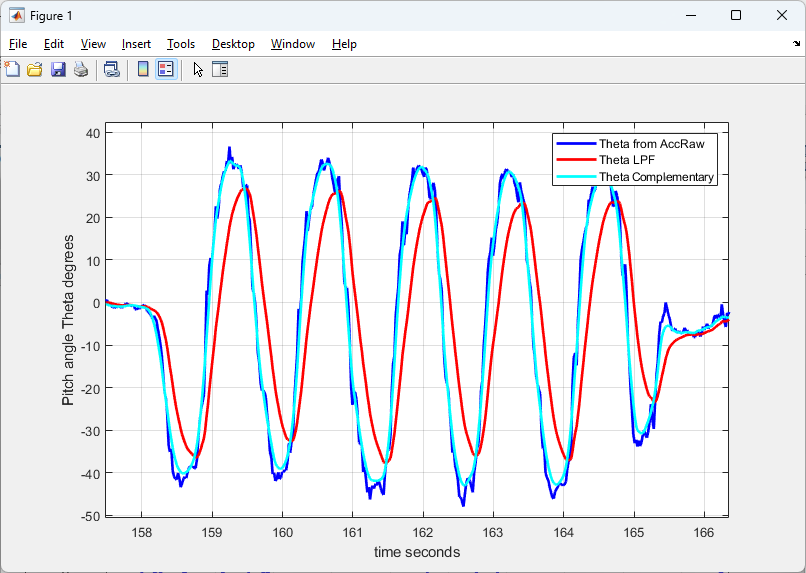
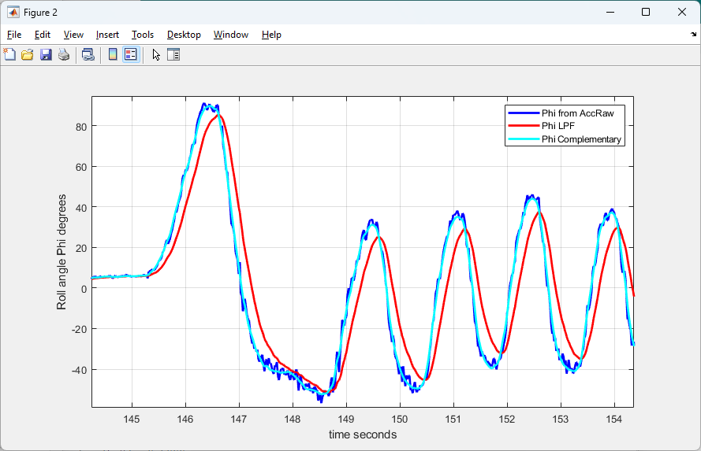

**3. Robustness to jerk and vibration.** The complementary filter is less sensitive to jerk and vibration than the accelerometer-only angle.

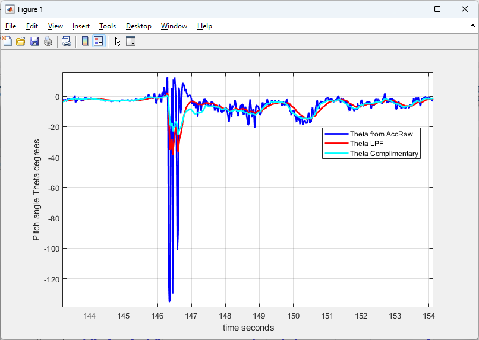

**4. Linear acceleration.** Gravity is computed from the filtered tilt and subtracted from the accelerometer to get linear acceleration. With the LPF tilt (blue), tilting the board leaks into the linear-acceleration estimate. With the complementary tilt (light blue), tilting is mostly removed, and real translation stands out clearly.

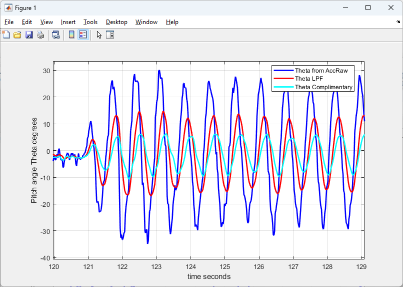

**5. Kalman filter comparison (exploratory).** With a gyro bias, the complementary filter's angle can sit offset from the truth (cyan, about 7° high here), because it trusts the integrated gyro over short times. The Kalman filter estimates the bias and stays with the accelerometer/LPF trend.

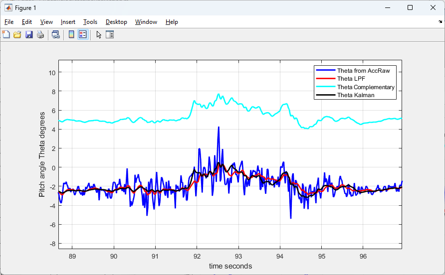
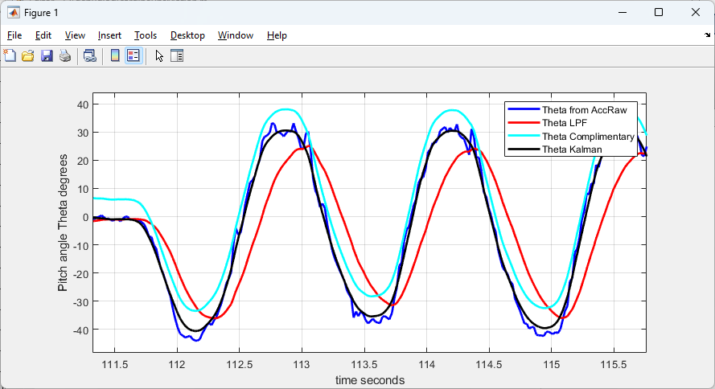
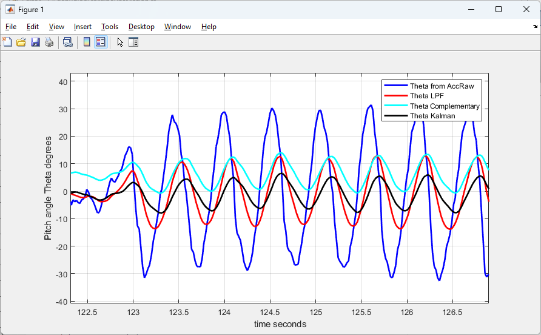

**6. Gesture detection.** Thresholds on linear acceleration (about ±0.15–0.2 g per axis) classify left/right, forward/backward, and up/down motion. The X signal from the complementary filter stays robust to tilt and has no lag.

After each detected event there is a 250 ms lockout (25 samples). Without it, the deceleration phase of a movement triggers a false opposite-direction gesture.

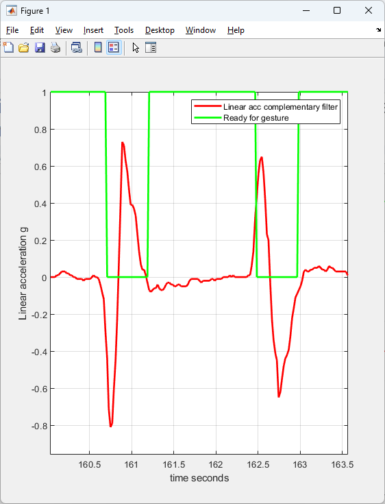

**Use with ML:** The complementary filter output replaces the LPF output as the feature input to the drone motion model.

Video link https://youtube.com/shorts/QBpUvBzy3HY

---

## Project 2: GPS + INS navigation (`myGPS`)

**Goal:** Produce a smooth, high-rate position estimate that stays usable between GPS fixes and during GPS outages.

**Approach**
- **INS (about 50 Hz):** Rotate BNO055 linear acceleration into East/North using heading, then integrate twice. Smooth and fast, but position drifts without bound.
- **GPS (about 1 Hz):** Convert lat/lon to local meters around the first fix (flat-earth approximation). Noisy and sometimes missing, but doesn't drift.
- **Complementary fusion:** 90% INS / 10% GPS for position on each GPS update, with velocity damping. Trust INS short-term, GPS long-term.
- **Simulated outage:** In `gpsplusInsKalman`, sending `b` over serial ignores GPS for 10 s.

### Results

**1. INS-only drifts; fusion bounds the error.** In a short walk, INS alone (red) wanders away from GPS (blue). The complementary GPS+INS track (cyan) stays near it.

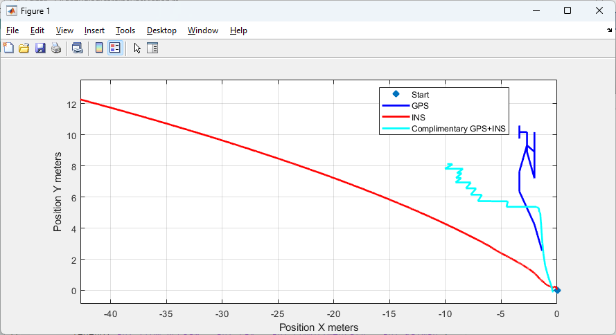
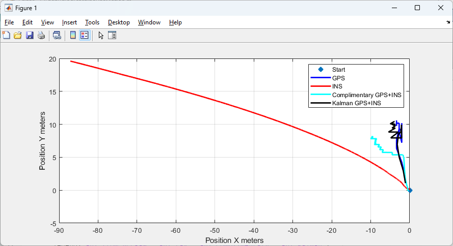

**2. Filling GPS gaps on a loop.** The fused estimate (cyan) gives a continuous, smooth track where GPS fixes (blue) have gaps (arrows), while INS-only (red) runs off the loop entirely.

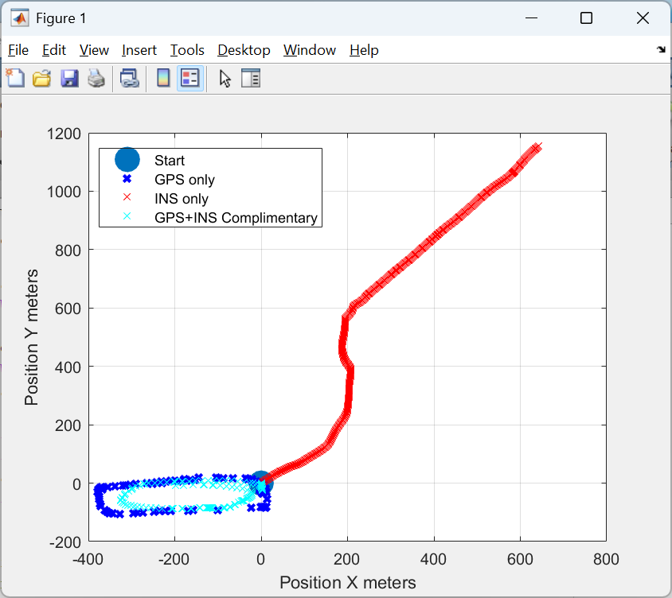
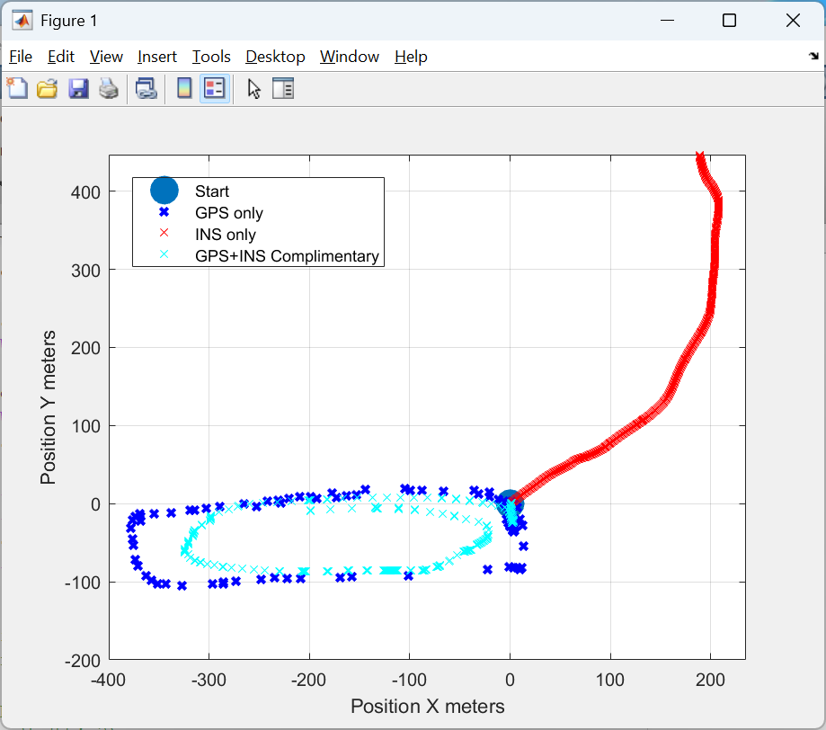
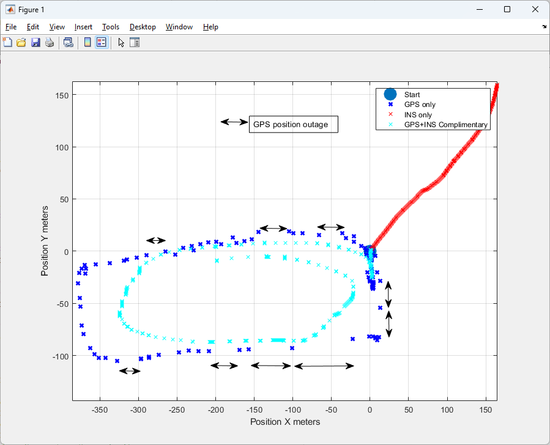

**3. Complementary vs Kalman.** Both fused solutions follow the loop. The complementary track is smoother, while the Kalman points follow the GPS more closely but are more scattered. Neither has been tuned systematically yet.

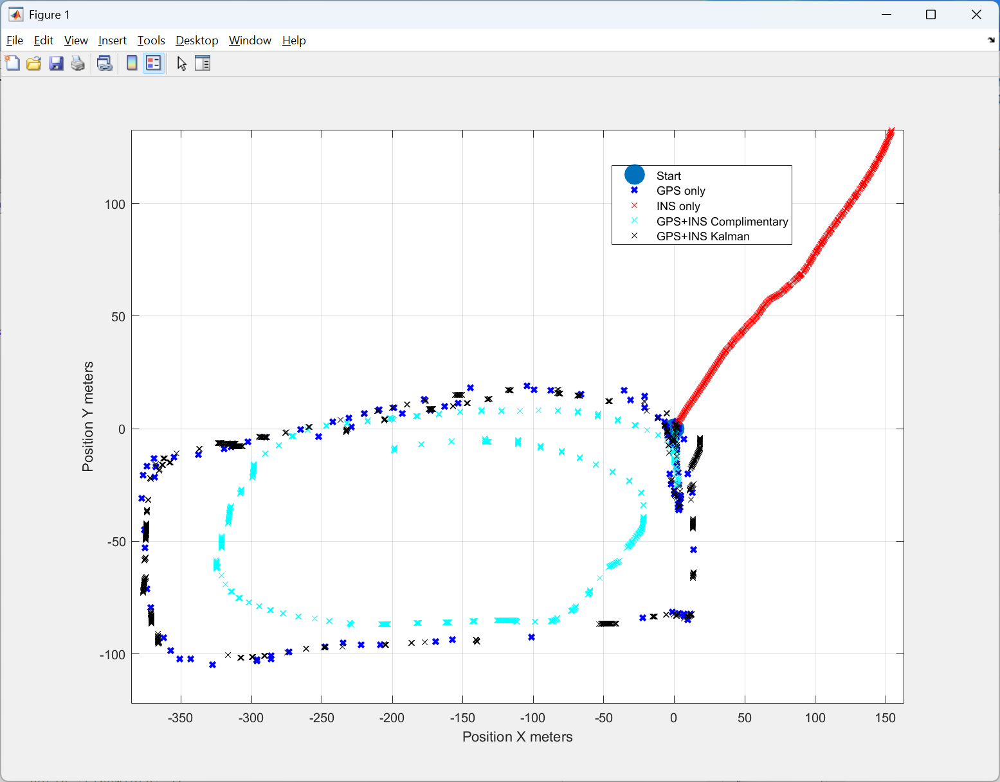

### Limitations (what I learned)
- **Fixed gains.** The 90/10 blend can't adapt to changing measurement noise or dynamics, so a position offset remains (visible in the loop plots) and high-dynamic maneuvers hurt.
- **No accelerometer-bias estimation**, so integration error accumulates.
- **2D projection ignores tilt**, so accuracy drops when the device isn't level.
- The flat-earth conversion is only valid over small areas.

## Next steps: adaptive estimation
The Kalman code in this repo is an early, exploratory comparison. Planned work:
- Tune process/measurement noise (Q/R) from logged data and evaluate on repeated runs
- Adapt gain to measurement noise and platform dynamics
- Add accelerometer-bias estimation
- Report error numbers against a surveyed reference path

## Project 3: Smart car (`mySmartCar4.0`)
[What it does, sensors, servo version, photo/video.]

## Project 4: Blink (`MyBlink`)
Hardware bring-up.

## How to run
1. Install the libraries above in the Arduino IDE.
2. Wire the BNO055 (I2C) and GPS (pins 2/3).
3. Open the `.ino`, upload, and open the Serial Monitor at 115200 baud.
4. Save the CSV output and plot in MATLAB or Python.

## Credits
[Libraries and references, including any source the Kalman code was adapted from.]
